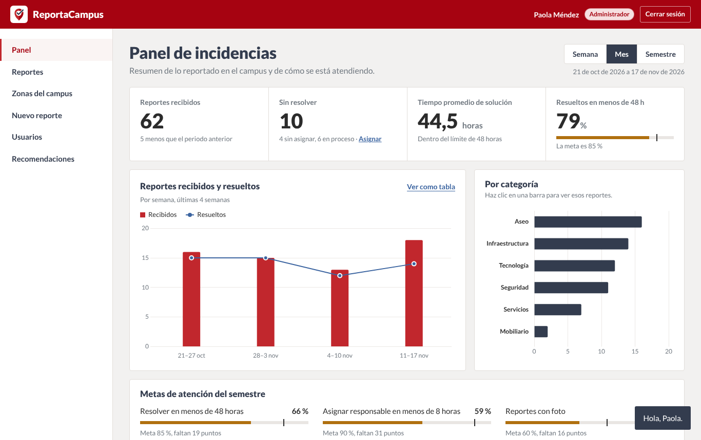
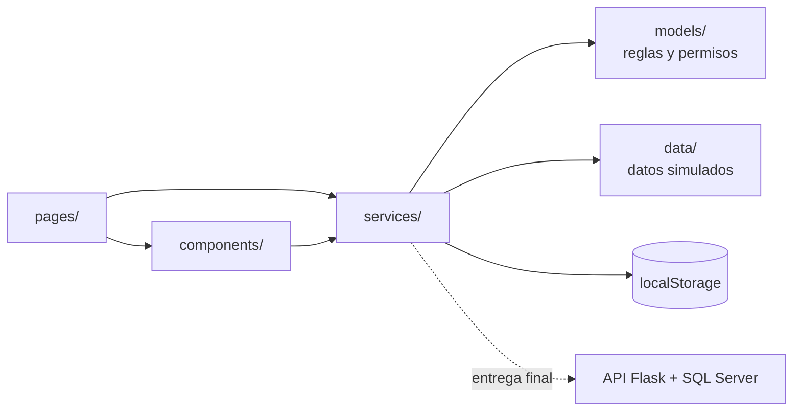
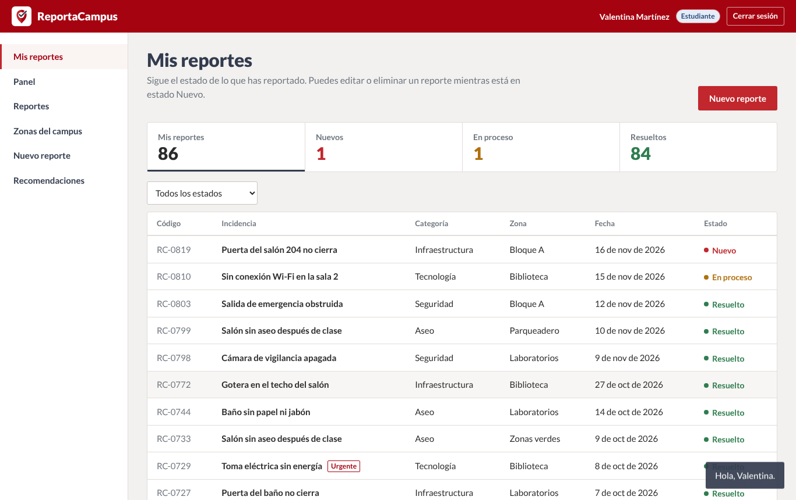
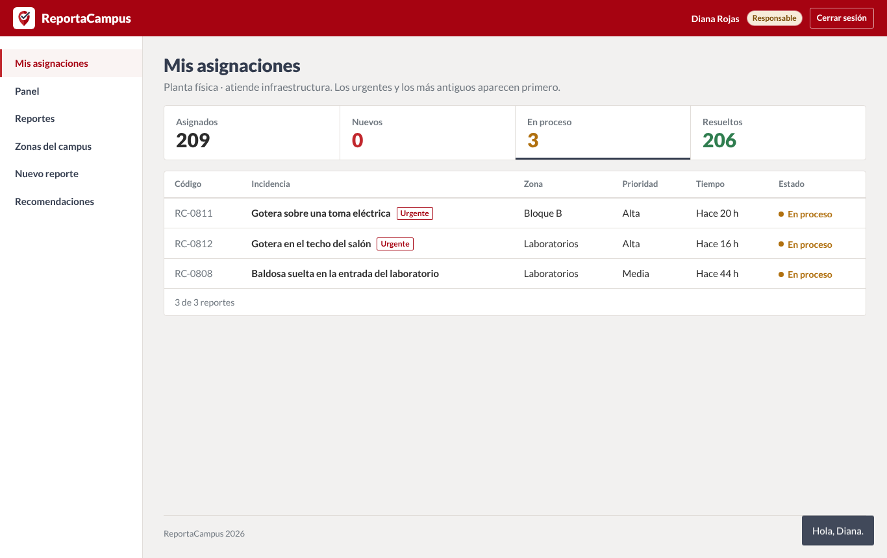
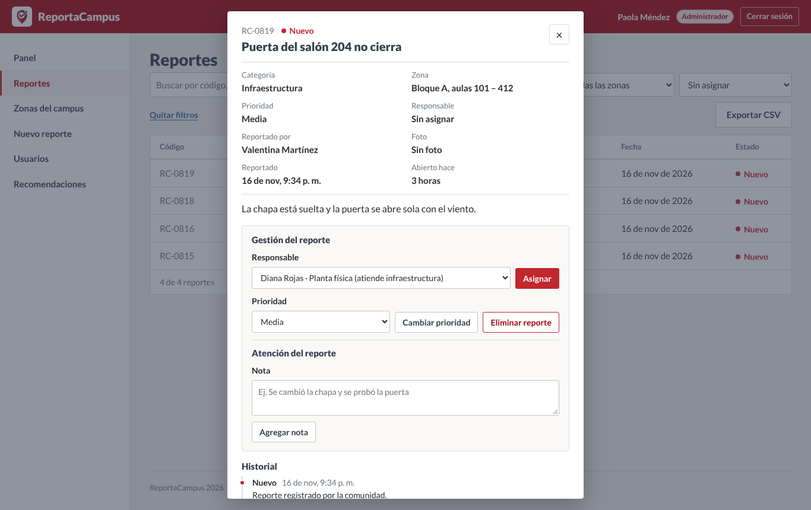
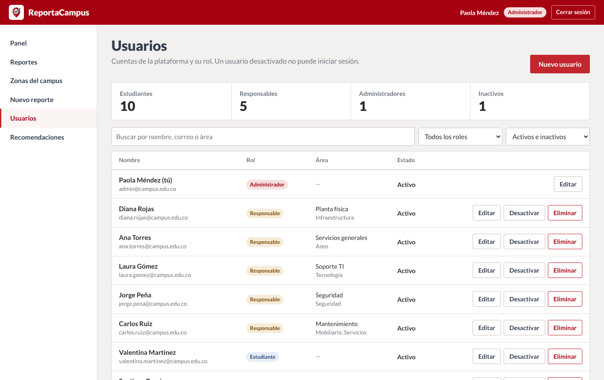
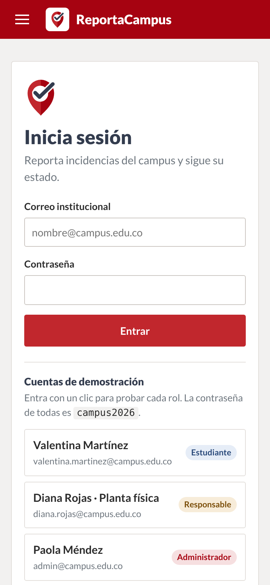
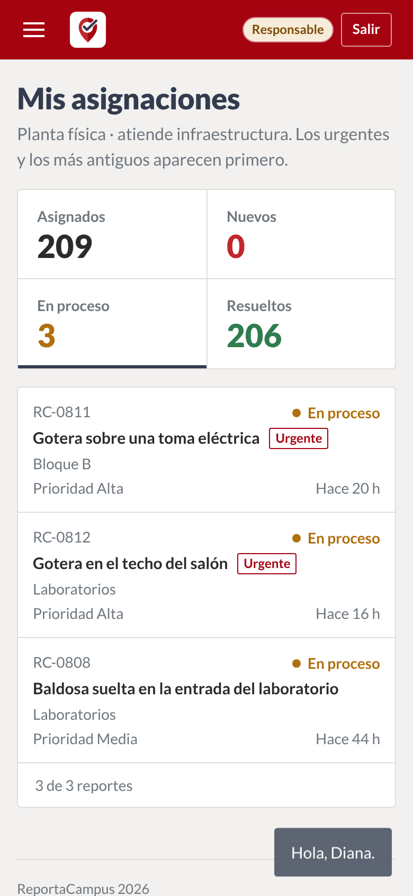
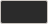

<p align="center"></p>

# ReportaCampus

**EJECUCION:** https://elone1415.github.io/ReportaCampus/

ReportaCampus es una aplicación web para reportar las incidencias del campus (daños, fallas, problemas de aseo o de seguridad) y hacer seguimiento a su atención. La comunidad reporta, los responsables de cada dependencia atienden lo que tienen asignado y el administrador reparte el trabajo y gestiona las cuentas.

Esta es la **versión 0.3 (Fase II)**: producto web con inicio de sesión, tres roles con permisos, gestión de reportes y de usuarios, arquitectura por capas y pruebas automáticas. Los datos se guardan en el navegador; el backend llega en la entrega final.



## Cuentas de demostración

Todas usan la contraseña **`campus2026`**. En la página de inicio de sesión hay un botón para entrar con cada una.

| Rol | Nombre | Correo | Llega a |
|---|---|---|---|
| Estudiante | Valentina Martínez | `valentina.martinez@campus.edu.co` | Mis reportes |
| Responsable | Diana Rojas (Planta física) | `diana.rojas@campus.edu.co` | Mis asignaciones |
| Administrador | Paola Méndez | `admin@campus.edu.co` | Panel |

Hay 16 cuentas en total (10 estudiantes, 5 responsables y 1 administrador); se ven en *Usuarios* con la cuenta de administrador. `mateo.sanchez@campus.edu.co` está desactivada a propósito para probar el rechazo del inicio de sesión.

## Información general

### Problemática

En el campus los daños y problemas se reportan de palabra, por correo o en grupos de chat. Los reportes se pierden o se repiten, nadie sabe quién los atiende y quien reporta no se entera de si se resolvió. Tampoco hay datos para saber cuánto tarda la atención ni qué zonas concentran más problemas.

### Objetivo general

Desarrollar una aplicación web que permita a la comunidad universitaria reportar incidencias del campus y consultar su estado, mientras los responsables las gestionan desde un panel, con el fin de reducir el tiempo de respuesta, evitar reportes perdidos o repetidos y dar trazabilidad a cada caso.

### Alcance

**Incluido en el proyecto:** registro y seguimiento de reportes con foto, roles de estudiante, responsable y administrador, asignación de responsables, cambios de estado con historial, panel de indicadores, gestión de usuarios, backend en Python con Flask y base de datos en SQL Server (entrega final).

**Fuera del alcance:** aplicación móvil nativa, notificaciones por correo, SMS o WhatsApp, integración con otros sistemas, mapas o GPS y clasificación automática con inteligencia artificial.

## Estado del proyecto

### Funcionalidades implementadas

| Módulo | Qué hace | Rol | Versión |
|---|---|---|---|
| Inicio de sesión | Validación de correo y contraseña, rechazo de cuentas desactivadas, cuentas de demostración, cierre de sesión. | Todos | v0.3 |
| Menú y rutas por rol | Cada rol ve solo sus secciones; las rutas sin permiso redirigen al inicio del rol. | Todos | v0.3 |
| Mis reportes | Resumen por estado que sirve de filtro y lista de los reportes propios. | Estudiante | v0.3 |
| Editar y eliminar reporte propio | Disponible mientras el reporte está en estado Nuevo; eliminar pide confirmación. | Estudiante | v0.3 |
| Mis asignaciones | Reportes a cargo del responsable, ordenados por prioridad y antigüedad. | Responsable | v0.3 |
| Atención del reporte | Agregar notas y marcar como resuelto con nota obligatoria. | Responsable, administrador | v0.3 |
| Gestión del reporte | Asignar o reasignar responsable (sugiere a quien atiende la categoría), cambiar prioridad, reabrir con nota y eliminar. | Administrador | v0.3 |
| Usuarios | Crear, editar, activar, desactivar y eliminar cuentas con validación; búsqueda y filtros por rol y estado; restablecer datos de demostración. | Administrador | v0.3 |
| Panel de incidencias | Indicadores, gráficas por semana, mes o semestre (Chart.js), metas de atención y enlace a los reportes sin asignar. | Todos | v0.1, v0.3 |
| Lista de reportes | Búsqueda, filtros por estado, categoría, zona y responsable, paginación, detalle con historial. | Todos | v0.1, v0.3 |
| Exportar CSV | Descarga los reportes filtrados para Excel. | Responsable, administrador | v0.2 |
| Nuevo reporte | Formulario con validación y foto con vista previa. | Todos | v0.1, v0.2 |
| Zonas del campus | Tarjetas con los reportes abiertos de cada espacio; abren la lista filtrada. | Todos | v0.1 |
| Recomendaciones | Buenas prácticas para reportar. | Todos | v0.1 |

### Avances de la Fase II

- **Roles y permisos:** estudiante, responsable y administrador, con una matriz de permisos única (`src/models/roles.js`) que revisan tanto la interfaz como los servicios.
- **Gestión de información (CRUD):** reportes (crear, consultar, editar, eliminar, asignar, cambiar estado y prioridad) y usuarios (crear, consultar, editar, activar o desactivar, eliminar).
- **Arquitectura por capas:** el archivo único `js/app.js` de la Fase I se dividió en configuración, modelos, datos, servicios, componentes, páginas y utilidades con módulos ES.
- **Navegación por rutas** entre páginas, con los botones Atrás y Adelante del navegador y enlaces a listas filtradas.
- **Componentes reutilizables:** tabla de reportes, resumen por estado, detalle con acciones según el rol, ventana de confirmación, gráficas, aviso y menú.
- **Persistencia completa en el navegador** de reportes y usuarios, con migración de los reportes creados en la v0.2.
- **45 pruebas unitarias** (`npm test`) y 40 casos de prueba funcionales documentados con 20 capturas nuevas.
- **Documentación técnica** en `documentacion/` y estrategia de backend definida (endpoints, tablas y autenticación).

### Funcionalidades pendientes (entrega final)

| Pendiente | Detalle |
|---|---|
| Backend | API REST en Python con Flask, siguiendo el contrato de [ADR-005](documentacion/decisiones_tecnicas/ADR-005-estrategia-backend.md). |
| Base de datos | SQL Server con las tablas usuarios, reportes, historial, categorías y zonas. |
| Autenticación real | Contraseña propia de cada usuario cifrada en el servidor, token de sesión y cambio de contraseña. |
| Fotos en el servidor | Subir la imagen a la API en lugar de guardarla en el navegador. |
| Calificar la solución | El estudiante califica la atención cuando su reporte queda resuelto. |
| Alertas de 48 horas | Aviso de reportes que superan la meta de atención. |
| Responsable toma reportes | Tomar un reporte nuevo de su categoría sin esperar la asignación. |
| Auditoría | Registro de las acciones del administrador. |
| Pruebas de extremo a extremo | Automatizar en el navegador los casos funcionales con Playwright y probar la API con pytest. |

### Próximos pasos

1. Crear la carpeta `backend/` con Flask y conectar SQL Server.
2. Implementar los endpoints de autenticación y reportes, y luego los de usuarios.
3. Escribir los servicios del frontend que usan la API (`src/services/api/`) y cambiar `FUENTE_DATOS` a `'api'`.
4. Cargar los datos iniciales con un script de semilla.
5. Agregar las funcionalidades pendientes y automatizar las pruebas de extremo a extremo.
6. Publicar el backend y configurar CORS para GitHub Pages.

## Información técnica

### Tecnologías utilizadas

| Tecnología | Uso en el proyecto |
|---|---|
| HTML5 | Estructura semántica de las páginas (`header`, `nav`, `main`, `section`, `dialog`) y formularios. |
| CSS3 | Variables de color, Grid, Flexbox y *media queries*, divididos en cinco hojas por responsabilidad. |
| JavaScript (módulos ES) | Toda la lógica, sin frameworks ni compilación. Ver [ADR-001](documentacion/decisiones_tecnicas/ADR-001-javascript-sin-framework.md). |
| [Chart.js 4.6](https://www.chartjs.org/) | Gráficas interactivas del panel. Incluida en `public/vendor/` para funcionar sin internet. |
| Lato | Tipografía de la interfaz (licencia OFL), incluida en `public/fonts/`. |
| localStorage y sessionStorage | Persistencia de datos y de la sesión en esta fase. |
| Node.js (`node:test`) | Pruebas unitarias, sin dependencias externas. |
| Visual Studio Code, Git y GitHub | Editor, control de versiones y publicación (GitHub Pages). |
| Python con Flask y SQL Server | Backend y base de datos de la entrega final. |

### Arquitectura

Aplicación de una sola página organizada en capas. Las páginas usan componentes y servicios; los servicios aplican los permisos y las reglas de los modelos y guardan los datos. Ninguna página lee el almacenamiento directamente, así que en la entrega final se cambia la fuente de datos por la API sin tocar la interfaz.



Detalle de cada capa, flujo de una acción y rutas: [documentacion/arquitectura/arquitectura.md](documentacion/arquitectura/arquitectura.md).

### Estructura de carpetas

```
ReportaCampus/
├── index.html                Estructura de todas las páginas
├── package.json              Scripts start y test
├── public/                   Recursos estáticos: logo, tipografía y Chart.js
├── src/
│   ├── main.js               Punto de entrada: servicios, sesión y router
│   ├── router.js             Rutas por hash con control de permisos
│   ├── config/               Configuración general y tabla de rutas por rol
│   ├── models/               Catálogos, reporte, usuario, roles y permisos
│   ├── data/                 Datos simulados y usuarios de demostración
│   ├── services/             Almacenamiento y servicios de reportes, usuarios y autenticación
│   ├── components/           Tabla, resumen, detalle, acciones, confirmación, gráficas, menú y aviso
│   ├── pages/                Una por sección (login, mis-reportes, asignados, panel, reportes,
│   │                         zonas, nuevo, usuarios, recomendaciones)
│   ├── utils/                Formatos, fechas, periodos, CSV, imágenes y DOM
│   └── styles/               base, layout, components, pages y responsive
├── tests/                    Pruebas unitarias
└── documentacion/
    ├── arquitectura/
    ├── diagramas/
    ├── requerimientos/
    ├── pruebas/              Plan, resultados y evidencias (fase-1, fase-2)
    ├── decisiones_tecnicas/
    └── diseno/colores/
```

### Dependencias

El proyecto **no tiene dependencias que instalar**: `package.json` no declara ninguna.

| Recurso | Versión | Dónde está | Licencia |
|---|---|---|---|
| Chart.js | 4.6 | `public/vendor/chart.umd.min.js` | MIT (`public/vendor/CHARTJS-LICENSE.md`) |
| Lato | 400, 700, 900 | `public/fonts/` | OFL (`public/fonts/OFL-LICENSE.txt`) |

### Requisitos de ejecución

- Un navegador actualizado (Chrome, Edge, Firefox o Safari).
- Un servidor local, porque los navegadores no cargan módulos ES abiertos con doble clic (`file://`). Sirve cualquiera de estos: la extensión Live Server de Visual Studio Code, Python 3 o Node.js.
- Node.js 20 o superior solo para correr las pruebas.

### Instalación y ejecución

1. Clona el repositorio y entra a la carpeta:
   ```bash
   git clone https://github.com/ElOne1415/ReportaCampus.git
   cd ReportaCampus
   ```
2. Inicia un servidor local con una de estas opciones:
   - **Visual Studio Code:** clic derecho sobre `index.html` → *Open with Live Server*.
   - **Python:**
     ```bash
     python3 -m http.server 8000
     ```
     y abre <http://localhost:8000>.
   - **Node.js:**
     ```bash
     npm start
     ```
     y abre <http://localhost:8080>.
3. Entra con una de las [cuentas de demostración](#cuentas-de-demostración).

Para correr las pruebas:

```bash
npm test
```

Para revisar la vista de celular o tableta, abre las herramientas de desarrollo del navegador (`F12` en Windows, `Cmd + Option + I` en Mac) y activa el modo de dispositivo.

### Configuración

Los valores ajustables están en [`src/config/config.js`](src/config/config.js):

| Valor | Para qué | Valor actual |
|---|---|---|
| `FUENTE_DATOS` | Origen de los datos: `'local'` (navegador) o `'api'` (entrega final). | `'local'` |
| `API_URL` | Dirección de la API de Flask. | `http://localhost:5000/api` |
| `CONTRASENA_DEMO` | Contraseña de las cuentas de demostración. | `campus2026` |
| `CLAVES` | Nombres de las claves en localStorage y sessionStorage. | `reportacampus.v3.*` |
| `META_HORAS`, `META_CUMPLIMIENTO` | Meta de atención del panel. | 48 horas, 85 % |
| `TAMANO_PAGINA`, `FOTO_MAX_PX` | Filas por página y tamaño máximo de las fotos. | 10, 640 px |

Las rutas, su permiso y la página de inicio de cada rol están en [`src/config/rutas.js`](src/config/rutas.js).

Para volver a los datos iniciales: entra como administrador → *Usuarios* → *Restablecer datos*. También se puede borrar el almacenamiento del sitio desde las herramientas del navegador.

## Pruebas

- **Unitarias:** 45 pruebas de modelos, permisos y servicios, todas correctas ([resultado](documentacion/pruebas/resultados-pruebas-unitarias.txt)).
- **Funcionales:** 40 casos probados en Chrome a 1366, 820, 390 y 360 px, sin errores en la consola ([plan y resultados](documentacion/pruebas/plan-de-pruebas.md)).

| Estudiante | Responsable |
|---|---|
|  |  |

| Administrador: asignar responsable | Administrador: usuarios |
|---|---|
|  |  |

| Inicio de sesión en celular | Mis asignaciones en celular |
|---|---|
|  |  |

Todas las capturas: [Fase II](documentacion/pruebas/evidencias/fase-2/) · [Fase I](documentacion/pruebas/evidencias/fase-1/).

## Documentación

La documentación técnica está en [`documentacion/`](documentacion/README.md): arquitectura, diagramas (casos de uso, estados, modelo de datos y navegación), requerimientos con la matriz de permisos, plan de pruebas y decisiones técnicas.

## Colorimetría

La paleta combina un rojo como color principal de la marca con un gris pizarra para textos y navegación, sobre fondos neutros. Los colores están definidos como variables al inicio de `src/styles/base.css`.

El logo (`public/img/logo.svg`) es un marcador de ubicación con una marca de verificación: une la idea de reportar un lugar con la de un caso resuelto.

| Muestra | Nombre | Hex | Uso |
|---|---|---|---|
|  | Rojo oscuro | `#A60311` | Barra superior, enlace activo del menú, mensajes de error. |
|  | Rojo | `#C1272D` | Botón principal, reportes recibidos en la gráfica, estado Nuevo. |
|  | Gris pizarra | `#333C4E` | Títulos, menú, periodo seleccionado. |
|  | Azul | `#3B64A0` | Reportes resueltos en la gráfica, enlaces y foco del teclado. |
|  | Ámbar | `#B0700F` | Estado En proceso y metas no cumplidas. |
|  | Verde | `#2F7D4F` | Estado Resuelto y metas cumplidas. |
|  | Tinta | `#2B2B2B` | Texto principal. |
|  | Gris | `#6F777F` | Textos secundarios y etiquetas. |
|  | Línea | `#E1DDD9` | Bordes y separadores. |
|  | Fondo | `#F2F1F0` | Fondo general. |
|  | Blanco | `#FFFFFF` | Paneles, tablas y formularios. |

Los estados siempre se muestran con su nombre junto al color, para que no dependan solo de él. Cada rol tiene además una etiqueta de color en la barra superior: azul para estudiante, ámbar para responsable y rojo para administrador.

## Equipo

- Juan Diego Fajardo Suárez
- Juan Camilo Céspedes
- Sebastián Pérez

## Historial de versiones

| Versión | Fecha | Cambios |
|---|---|---|
| v0.1 | 3 de noviembre de 2026 | Estructura del repositorio, página principal, diseño adaptable, datos simulados, gráficas, filtros, formulario, detalle y navegación. |
| v0.2 | 10 de noviembre de 2026 | Reportes nuevos guardados en el navegador, vista previa de la foto, exportación a CSV y nuevas evidencias. |
| v0.3 | 17 de noviembre de 2026 | Fase II: inicio de sesión con roles, mis reportes, mis asignaciones, gestión de reportes y usuarios, arquitectura por capas con módulos ES, navegación por rutas, pruebas unitarias y documentación técnica. |
