<p align="center"></p>

# ReportaCampus

**EJECUCION:** https://elone1415.github.io/ReportaCampus/

ReportaCampus es una aplicación web para reportar las incidencias del campus (daños, fallas, problemas de aseo o de seguridad) y consultar en qué estado se encuentra cada una. Esta versión es el **prototipo web inicial (v0.1)**: una interfaz funcional construida con HTML5, CSS3 y JavaScript que trabaja con datos simulados.

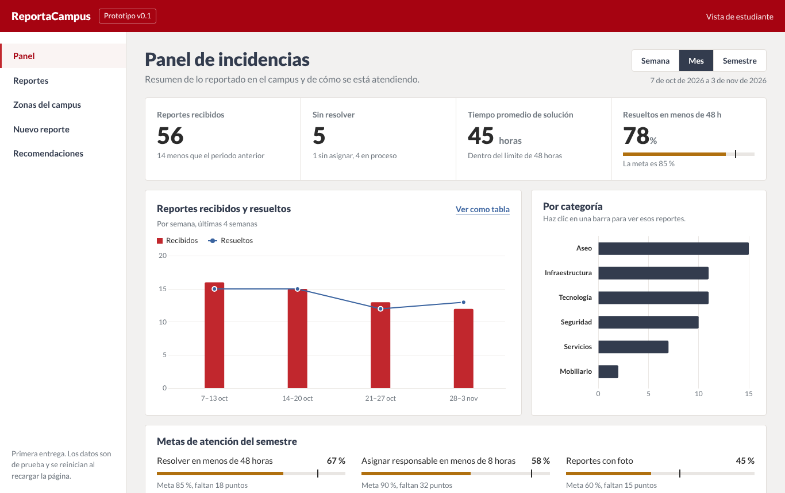

## Equipo

- Juan Diego Fajardo Suárez
- Juan Camilo Céspedes
- Sebastián Pérez

## Objetivo general

Desarrollar una aplicación web que permita a la comunidad universitaria reportar incidencias del campus y consultar su estado, mientras los responsables las gestionan desde un panel, con el fin de reducir el tiempo de respuesta, evitar reportes perdidos o repetidos y dar trazabilidad a cada caso.

## Alcance inicial

Esta primera entrega cubre la interfaz de la página principal con datos simulados.

| Módulo | Qué hace |
|---|---|
| Panel de incidencias | Muestra cuatro indicadores: reportes recibidos, reportes sin resolver, tiempo promedio de solución y porcentaje resuelto en menos de 48 horas. |
| Selector de periodo | Botones *Semana / Mes / Semestre* que recalculan los indicadores y las gráficas. |
| Gráfica de reportes | Barras de reportes recibidos y línea de resueltos (Chart.js), con detalle al pasar el cursor y opción *Ver como tabla*. |
| Gráfica por categoría | Al hacer clic en una barra se filtra la lista de reportes por esa categoría. |
| Metas de atención | Avance del semestre frente a tres metas, con barra de progreso. |
| Lista de reportes | Búsqueda por texto y filtros por estado, categoría y zona. Cada fila abre el detalle del reporte con su historial de estados. El botón *Exportar CSV* descarga los reportes filtrados para abrirlos en Excel. |
| Zonas del campus | Tarjetas por espacio (bloques, biblioteca, laboratorios, etc.) con el número de reportes abiertos; al elegir una se filtra la lista. |
| Nuevo reporte | Formulario con categoría, zona, título, descripción, prioridad y foto opcional con vista previa. Valida los campos obligatorios, agrega el reporte a la lista y lo guarda en el navegador. La foto se ve también en el detalle del reporte. |
| Recomendaciones | Buenas prácticas para reportar y para cuidar los espacios. |
| Navegación | Menú lateral con enlaces a cada sección; en celular se abre con el botón de menú. |

La interfaz se adapta a computador, tableta y celular.

**Elementos interactivos de esta entrega:** selector de periodo, gráficas con detalle y filtro por clic, búsqueda y filtros de la lista, detalle de reportes, tarjetas de zonas, formulario con validación y menú de navegación.

**Siguientes entregas:** backend en Python con Flask, base de datos en SQL Server, inicio de sesión con roles (estudiante, responsable y administrador), asignación de responsables, cambio de estado desde el panel administrativo y carga real de fotos.

**Fuera del alcance del proyecto:** aplicación móvil nativa, notificaciones por correo, SMS o WhatsApp, integración con otros sistemas, mapas o GPS y clasificación automática con inteligencia artificial.

### Datos simulados

El archivo `js/data.js` genera un año de incidencias de prueba con un generador pseudoaleatorio con semilla, por lo que los datos son los mismos en cada carga. Los reportes creados desde el formulario se guardan en el navegador (`localStorage`), así que siguen en la lista al recargar la página. Se pueden borrar con el enlace *Borrar mis reportes* que aparece sobre el formulario.

## Tecnologías utilizadas

| Tecnología | Uso en el proyecto |
|---|---|
| HTML5 | Estructura semántica de la página (`header`, `nav`, `main`, `section`, `dialog`) y formulario. |
| CSS3 | Estilos con variables de color, Grid, Flexbox y *media queries* para el diseño adaptable. |
| JavaScript | Lógica de la interfaz sin frameworks: indicadores, filtros, formulario, detalle y navegación. |
| [Chart.js 4.6](https://www.chartjs.org/) | Biblioteca para las gráficas interactivas. Se eligió porque es liviana, no necesita compilación y trae tooltips y adaptación de tamaño. Está incluida en `js/vendor/` para que el prototipo funcione sin internet. |
| Lato | Tipografía de la interfaz (licencia OFL), incluida en `assets/fonts/`. |
| Visual Studio Code | Editor de código. |
| Git y GitHub | Control de versiones y publicación del repositorio. |

## Colorimetría

La paleta combina un rojo como color principal de la marca con un gris pizarra para textos y navegación, sobre fondos neutros. Los colores están definidos como variables al inicio de `css/styles.css`.

El logo (`assets/img/logo.svg`) es un marcador de ubicación con una marca de verificación: une la idea de reportar un lugar con la de un caso resuelto. Usa el rojo (mitad izquierda), el rojo oscuro (mitad derecha), el gris pizarra (marca de verificación) y el blanco. En la barra superior va sobre un recuadro blanco para que no se pierda contra el fondo rojo.

### Colores principales

| Muestra | Nombre | Hex | Uso |
|---|---|---|---|
| 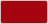 | Rojo oscuro | `#A60311` | Barra superior, enlace activo del menú, mensajes de error. |
| 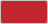 | Rojo | `#C1272D` | Botón principal, barras de reportes recibidos en la gráfica, borde del enlace activo. |
| 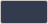 | Gris pizarra | `#333C4E` | Títulos, menú lateral, periodo seleccionado, barras de la gráfica por categoría. |
| 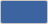 | Azul | `#3B64A0` | Línea de reportes resueltos, enlaces y foco del teclado. |

### Neutros

| Muestra | Nombre | Hex | Uso |
|---|---|---|---|
| 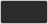 | Tinta | `#2B2B2B` | Texto principal y cifras de los indicadores. |
| 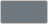 | Gris | `#6F777F` | Textos secundarios, etiquetas y ejes de las gráficas. |
| 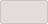 | Línea | `#E1DDD9` | Bordes de paneles, tablas y separadores. |
| 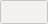 | Fondo | `#F2F1F0` | Fondo general de la página. |
| 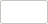 | Blanco | `#FFFFFF` | Fondo de paneles, tablas y formulario. |

### Estados de un reporte

| Muestra | Estado | Hex | Uso |
|---|---|---|---|
|  | Nuevo | `#C1272D` | Reporte recibido que aún no tiene responsable. |
| 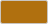 | En proceso | `#B0700F` | Reporte asignado y en atención; también metas aún no cumplidas. |
| 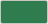 | Resuelto | `#2F7D4F` | Reporte cerrado; también metas cumplidas. |

Los estados siempre se muestran con su nombre junto al color, para que no dependan solo de él. Los dos colores de la gráfica principal (rojo y azul) se verificaron para que se distingan también con daltonismo.

## Instrucciones para ejecutar el prototipo

No requiere instalar dependencias ni conexión a internet.

1. Clona el repositorio:
   ```bash
   git clone https://github.com/ElOne1415/ReportaCampus.git
   ```
2. Entra a la carpeta del proyecto:
   ```bash
   cd ReportaCampus
   ```
3. Abre el archivo `index.html` en un navegador actualizado (Chrome, Edge, Firefox o Safari).

También se puede servir en local:

- Con la extensión **Live Server** de Visual Studio Code: clic derecho sobre `index.html` y *Open with Live Server*.
- Desde la terminal, dentro de la carpeta del proyecto:
  ```bash
  python3 -m http.server 8000
  ```
  y abrir <http://localhost:8000> en el navegador.

Para revisar la vista de celular o tableta, abre las herramientas de desarrollo del navegador (`F12` en Windows, `Cmd + Option + I` en Mac) y activa el modo de dispositivo.

## Estructura del repositorio

```
ReportaCampus/
├── index.html            Página principal
├── css/
│   └── styles.css        Estilos, paleta y diseño adaptable
├── js/
│   ├── data.js           Datos simulados
│   ├── charts.js         Gráficas
│   ├── app.js            Lógica de la interfaz
│   └── vendor/           Chart.js
├── assets/
│   ├── img/              Logo
│   └── fonts/            Tipografía Lato
└── docs/
    ├── colores/          Muestras de la paleta
    └── evidencias/       Capturas del prototipo
```

## Verificación del funcionamiento

Se probó en Google Chrome en tres tamaños de pantalla: 1366 px (computador), 820 px (tableta) y 390 px (celular).

| Prueba | Resultado |
|---|---|
| La página carga sin errores en la consola | Correcto |
| Cambiar el periodo actualiza indicadores y gráficas | Correcto |
| Detalle al pasar el cursor y vista en tabla de la gráfica | Correcto |
| Clic en una categoría filtra la lista de reportes | Correcto |
| Búsqueda y filtros de la lista | Correcto |
| El formulario marca los campos obligatorios vacíos | Correcto |
| Un reporte nuevo aparece primero en la lista y suma en los indicadores | Correcto |
| El detalle muestra el historial de estados | Correcto |
| Menú lateral en computador y menú desplegable en celular | Correcto |
| Sin desplazamiento horizontal en los tres tamaños | Correcto |

## Evidencias

| Computador | Celular |
|---|---|
|  | 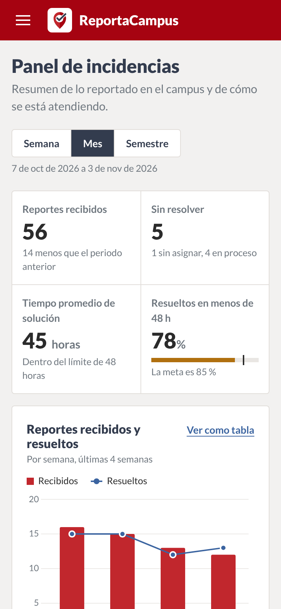 |

Gráfica con el periodo *Semestre* y detalle al pasar el cursor:

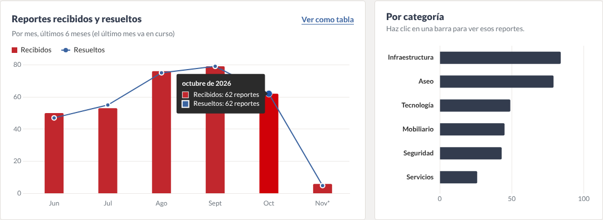

Todas las capturas están en [`docs/evidencias/`](docs/evidencias/):

| Archivo | Qué muestra |
|---|---|
| `01-escritorio-panel.png` | Panel en computador |
| `02-escritorio-pagina-completa.png` | Página completa |
| `03-grafica-semestre.png` | Gráfica por semestre con detalle |
| `04-grafica-semana-tabla.png` | Gráfica por semana con vista en tabla |
| `05-filtro-categoria.png` | Lista filtrada desde la gráfica de categorías |
| `06-formulario-validacion.png` | Validación del formulario |
| `07-reporte-enviado.png` | Reporte nuevo en la lista |
| `08-detalle-historial.png` | Detalle e historial de un reporte |
| `09-movil-panel.png` | Panel en celular |
| `10-movil-menu.png` | Menú en celular |
| `11-movil-reportes.png` | Lista de reportes en celular |
| `12-tableta-panel.png` | Panel en tableta |
