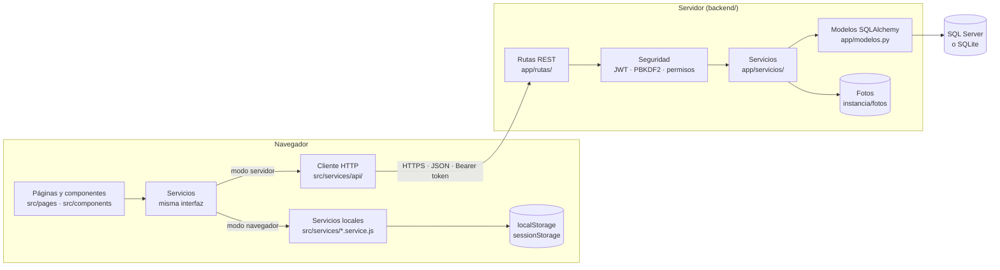
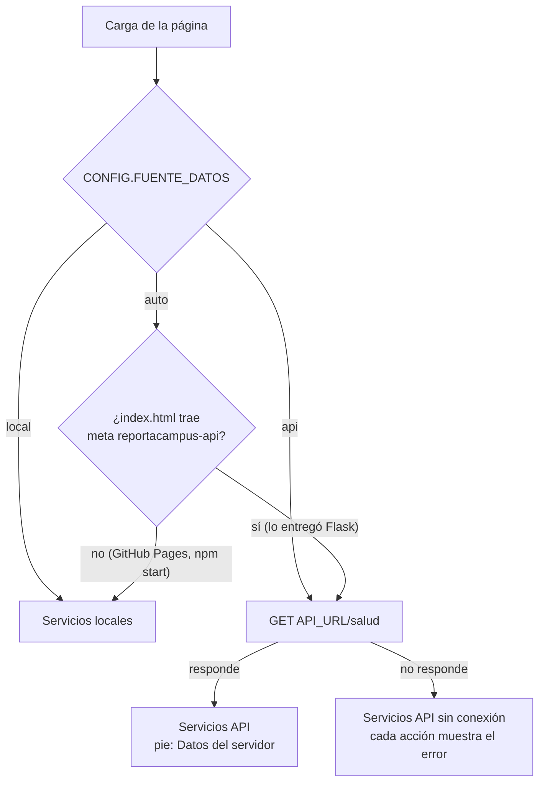
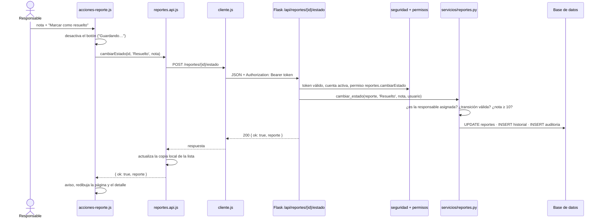
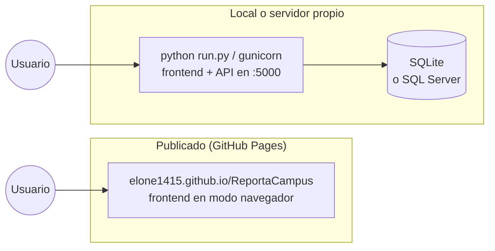

# Arquitectura final de ReportaCampus

Versión 1.0.0. ReportaCampus es una aplicación web de una sola página (SPA) con un backend REST:

- **Frontend:** HTML5, CSS3 y JavaScript con módulos ES, sin frameworks ni compilación.
- **Backend:** API REST en Python con Flask y SQLAlchemy.
- **Base de datos:** SQLite en desarrollo y pruebas, SQL Server en producción.

El mismo frontend funciona con el servidor o, sin él, con datos de demostración guardados en el navegador (GitHub Pages).

## 1. Vista general

| Pieza | Responsabilidad |
|---|---|
| **Páginas** (`src/pages/`) | Una por sección: inicio de sesión, mis reportes, mis asignaciones, panel, reportes, zonas, nuevo reporte, usuarios, actividad, mi cuenta y recomendaciones. Cada una expone `montar()` y `mostrar(params)`. |
| **Componentes** (`src/components/`) | Piezas reutilizables: tabla de reportes paginada (cuatro tablas en tres páginas), resumen por estado, detalle con acciones según el rol, confirmación, gráficas, carga y error, menú y avisos. |
| **Modelos del frontend** (`src/models/`) | Reglas sin DOM: catálogos, validaciones, transiciones de estado y matriz de permisos. |
| **Servicios** (`src/services/`) | Única puerta a los datos. Hay dos implementaciones con la misma interfaz: local (navegador) y API (`fetch`). `iniciarServicios()` elige cuál usar. |
| **Router** (`src/router.js`) | Rutas por hash (`#/reportes?zona=biblioteca`) con permisos por ruta. |
| **Rutas del backend** (`backend/app/rutas/`) | Endpoints REST de autenticación, reportes, usuarios, auditoría, fotos y sistema. Además entregan el frontend en `/`. |
| **Seguridad** (`seguridad.py`, `permisos.py`) | Contraseñas con PBKDF2, tokens JWT y la misma matriz de permisos del frontend. |
| **Servicios del backend** (`backend/app/servicios/`) | Reglas de cada operación, validación de fotos y registro de auditoría. |
| **Modelos SQLAlchemy** (`modelos.py`) | Tablas; el mismo código sirve para SQLite y SQL Server. |

## 2. Separación de responsabilidades

- Las **páginas** no saben de dónde vienen los datos: llaman a `app.reportes`, `app.usuarios`, `app.auth` y `app.auditoria`.
- Los **modelos** y los **servicios locales** no usan el DOM, así que se prueban con Node.
- Los **permisos** se revisan tres veces: la interfaz muestra solo lo permitido, los servicios locales rechazan lo que no corresponde y el backend vuelve a revisar cada petición. La matriz es la misma en `src/models/roles.js` y `backend/app/permisos.py`, y una prueba falla si se diferencian.
- Las **validaciones** tienen los mismos mensajes en el frontend y el backend: el usuario ve el mismo texto en los dos modos.
- La **configuración** está separada del código: `src/config/` en el frontend y variables de entorno (`.env`) en el backend.

## 3. Cómo se elige la fuente de datos

Flask agrega `<meta name="reportacampus-api">` al entregar `index.html`. Así, en GitHub Pages no se hace ninguna petición de prueba y la consola queda sin errores. Ver [ADR-007](../decisiones_tecnicas/ADR-007-fuente-de-datos-automatica.md).

## 4. Flujo de información

Ejemplo: la responsable marca un reporte como resuelto con el servidor.

Si algo falla, cada capa responde con la misma forma (`{ ok: false, error }` o `{ ok: false, errores }`):

| Situación | Dónde se detecta | Qué ve el usuario |
|---|---|---|
| Nota muy corta | `validar_cambio_estado` (backend) | Mensaje debajo del campo; la ventana sigue abierta. |
| Sin permiso | `requiere_permiso` / `puede_cambiar_estado` | Aviso rojo: *No tienes permiso para hacer esto.* |
| Token vencido o cuenta desactivada | `requiere_sesion` → 401 | Vuelve al inicio de sesión con *Tu sesión terminó.* |
| Sin conexión o servidor caído | `cliente.js` | Aviso rojo o error en la página con **Reintentar**; el formulario conserva lo escrito. |
| Error inesperado | manejador global de Flask → 500 | *Ocurrió un error en el servidor. Intenta de nuevo.* |

## 5. Rutas del frontend

| Ruta | Página | Permiso | Roles |
|---|---|---|---|
| `#/login` | Inicio de sesión | pública | sin sesión |
| `#/mis-reportes` | Mis reportes | `reportes.propios` | estudiante (inicio) |
| `#/asignados` | Mis asignaciones | `reportes.asignados` | responsable (inicio) |
| `#/panel` | Panel | `panel.ver` | todos (inicio del administrador) |
| `#/reportes` | Reportes, con filtros en la URL | `reportes.ver` | todos |
| `#/zonas` | Zonas del campus | `reportes.ver` | todos |
| `#/nuevo` | Nuevo reporte (`?editar=RC-0001` para editar) | `reportes.crear` | todos |
| `#/usuarios` | Usuarios | `usuarios.gestionar` | administrador |
| `#/actividad` | Actividad | `auditoria.ver` | administrador |
| `#/recomendaciones` | Recomendaciones | `reportes.ver` | todos |
| `#/cuenta` | Mi cuenta | `panel.ver` | todos |

## 6. Despliegue

- **GitHub Pages** publica la rama `main`. Sin backend, funciona con los datos de demostración en el navegador.
- **Backend:** se ejecuta en local con `python run.py` y está preparado para un servidor con `gunicorn`. Los pasos están en el [manual técnico](../manual_tecnico/manual-tecnico.md#10-despliegue).

## 7. Almacenamiento

| Dónde | Qué |
|---|---|
| Base de datos (servidor) | Tablas `usuarios`, `categorias`, `zonas`, `responsable_categorias`, `reportes`, `historial` y `auditoria` ([modelo de datos](../diagramas/modelo-datos.md)). |
| `backend/instancia/fotos/` | Fotos de los reportes, con nombre aleatorio. |
| `sessionStorage` | Sesión: con servidor `{ token, usuario }`; en modo navegador `{ usuarioId }`. |
| `localStorage` (solo modo navegador) | `reportacampus.v3.reportes`, `.usuarios` y `.auditoria`. |

## 8. Estructura de carpetas

La estructura completa, archivo por archivo, está en el [manual técnico](../manual_tecnico/manual-tecnico.md#5-estructura-del-código).
