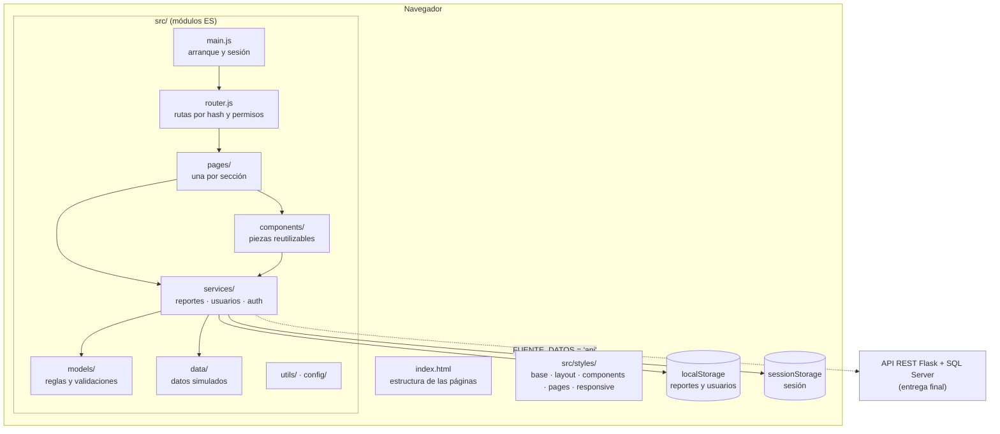
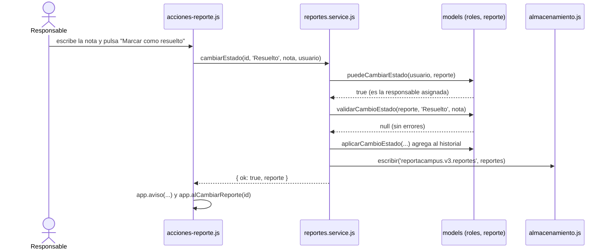

# Arquitectura de ReportaCampus

Versión 0.3.0 (Fase II). Esta versión es una aplicación de una sola página (SPA) hecha con HTML5, CSS3 y JavaScript con módulos ES, sin frameworks ni proceso de compilación. Los datos se guardan en el navegador. El diseño separa las capas para que en la entrega final se agregue el backend en Flask con SQL Server sin rehacer la interfaz (ver [ADR-005](../decisiones_tecnicas/ADR-005-estrategia-backend.md)).

## Vista general



## Capas y responsabilidades

| Capa | Carpeta | Responsabilidad | Puede usar |
|---|---|---|---|
| Configuración | `src/config/` | Valores que cambian sin tocar la lógica: metas, claves de almacenamiento, origen de datos, URL de la API, rutas y página de inicio de cada rol. | — |
| Modelos | `src/models/` | Reglas del negocio sin DOM: catálogos, validación de reportes y usuarios, transiciones de estado, matriz de permisos. | config |
| Datos simulados | `src/data/` | Generador de reportes con semilla y usuarios de demostración. Se reemplaza por la base de datos. | models |
| Servicios | `src/services/` | Única puerta a los datos. Revisan permisos, validan con los modelos y guardan. Métodos asíncronos (`async`) con respuestas `{ ok, ... }`. | models, data, config |
| Componentes | `src/components/` | Piezas de interfaz reutilizables: tabla de reportes, resumen por estado, detalle, acciones según el rol, confirmación, gráficas, aviso y menú. | services (a través de `app`), models, utils |
| Páginas | `src/pages/` | Una por sección. Cada página expone `montar()` (se llama una vez) y `mostrar(params)` (cada vez que se entra a la ruta). | components, services (a través de `app`) |
| Router | `src/router.js` | Lee el hash de la URL, aplica los permisos de la ruta y avisa a `main.js`. | — |
| Arranque | `src/main.js` | Crea los servicios, monta las páginas, maneja la sesión y conecta el router. | todo |
| Utilidades | `src/utils/` | Formatos, fechas, periodos, CSV, imágenes y atajos del DOM. | config |
| Estilos | `src/styles/` | `base` (variables y reinicio), `layout` (estructura), `components`, `pages` y `responsive`. | — |
| Recursos estáticos | `public/` | Logo, tipografía Lato y Chart.js. | — |

Reglas de dependencia:

- Los **modelos** y los **servicios** no tocan el DOM. Por eso se prueban con Node (`npm test`).
- Las **páginas** no leen `localStorage` directamente; siempre pasan por los servicios.
- Los **permisos** se revisan dos veces: en la interfaz, para mostrar solo lo que el usuario puede hacer, y en los servicios, para rechazar la operación aunque alguien llame al método a mano. El backend de la entrega final repetirá la segunda revisión.

## El objeto `app`

`main.js` crea un objeto `app` que reciben todas las páginas. Así las páginas no importan unas de otras.

| Propiedad | Para qué |
|---|---|
| `app.reportes`, `app.usuarios`, `app.auth` | Servicios. |
| `app.usuario` | Usuario con sesión abierta. |
| `app.puede(permiso)` | Atajo de `puede(app.usuario, permiso)`. |
| `app.irA(ruta, params)` | Navegar (cambia el hash). |
| `app.abrirReporte(id)` / `app.cerrarDetalle()` | Ventana de detalle. |
| `app.alCambiarReporte(id)` | Después de una acción: redibuja la página y el detalle. |
| `app.recargarPagina()` | Redibuja la página actual conservando filtros y paginación. |
| `app.aviso(texto)` | Mensaje temporal. |
| `app.estado.filtros` | Filtros de la lista de reportes (se comparten con el panel y las zonas). |

## Flujo de una acción

Ejemplo: la responsable marca un reporte como resuelto.



Si la nota es muy corta, `validarCambioEstado` devuelve el mensaje y el servicio responde `{ ok: false, error }`. El componente lo muestra debajo del campo sin cerrar la ventana.

## Rutas

| Ruta | Página | Permiso | Roles |
|---|---|---|---|
| `#/login` | Inicio de sesión | pública | sin sesión |
| `#/mis-reportes` | Mis reportes | `reportes.propios` | estudiante (inicio) |
| `#/asignados` | Mis asignaciones | `reportes.asignados` | responsable (inicio) |
| `#/panel` | Panel de incidencias | `panel.ver` | todos (inicio del administrador) |
| `#/reportes` | Reportes (acepta `?estado=`, `?categoria=`, `?zona=`, `?responsableId=`, `?resaltar=`) | `reportes.ver` | todos |
| `#/zonas` | Zonas del campus | `reportes.ver` | todos |
| `#/nuevo` | Nuevo reporte (`?editar=RC-0001` para editar) | `reportes.crear` | todos |
| `#/usuarios` | Usuarios | `usuarios.gestionar` | administrador |
| `#/recomendaciones` | Recomendaciones | `reportes.ver` | todos |

Sin sesión, cualquier ruta lleva a `#/login` y, al entrar, el usuario vuelve a la página que había pedido. Con sesión, una ruta sin permiso lleva a la página de inicio del rol con el aviso *No tienes acceso a esa sección*.

## Almacenamiento

| Clave | Dónde | Contenido |
|---|---|---|
| `reportacampus.v3.reportes` | localStorage | Lista completa de reportes (se crea con los datos simulados la primera vez). |
| `reportacampus.v3.usuarios` | localStorage | Lista de usuarios. |
| `reportacampus.sesion` | sessionStorage | `{ usuarioId, inicio }`. Termina al cerrar la pestaña. |
| `reportacampus.reportes` | localStorage | Clave de la v0.2. Si existe, sus reportes se migran a la nueva estructura y la clave se borra. |

El administrador puede volver a los datos iniciales con *Usuarios → Restablecer datos*.

## Estructura de carpetas

```
ReportaCampus/
├── index.html                  Estructura de todas las páginas
├── package.json                Scripts start y test (sin dependencias)
├── public/                     Recursos estáticos
│   ├── img/logo.svg
│   ├── fonts/                  Lato (licencia OFL)
│   └── vendor/                 Chart.js 4.6 (licencia MIT)
├── src/
│   ├── main.js                 Punto de entrada
│   ├── router.js               Rutas por hash
│   ├── config/                 config.js, rutas.js
│   ├── models/                 catalogos, reporte, usuario, roles
│   ├── data/                   semilla (reportes), usuarios
│   ├── services/               index, almacenamiento, reportes, usuarios, auth
│   ├── components/             tabla-reportes, resumen-estados, detalle,
│   │                           acciones-reporte, confirmar, graficas,
│   │                           estado, navegacion, toast
│   ├── pages/                  login, mis-reportes, asignados, panel, reportes,
│   │                           zonas, nuevo, usuarios, recomendaciones
│   ├── utils/                  dom, formato, tiempo, periodos, csv, imagen
│   └── styles/                 base, layout, components, pages, responsive
├── tests/                      Pruebas unitarias (node:test)
└── documentacion/
    ├── arquitectura/           Este documento
    ├── diagramas/              Casos de uso, estados, datos, navegación
    ├── requerimientos/         Requerimientos, roles y permisos
    ├── pruebas/                Plan, resultados y evidencias
    ├── decisiones_tecnicas/    Registros de decisiones (ADR)
    └── diseno/colores/         Muestras de la paleta
```
