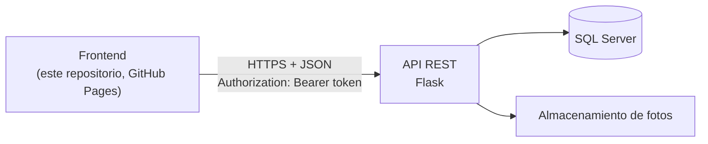

# ADR-005. Estrategia de backend: API REST en Flask con SQL Server

**Estado:** aceptada e implementada · entrega final (v1.0)

> **Cómo quedó.** El backend está en `backend/` y sigue este plan. Cambios respecto a la propuesta: se usó SQLAlchemy en lugar de SQL escrito a mano, para que el mismo código funcione con SQLite (desarrollo y pruebas) y SQL Server; las fotos llegan como *data URL* dentro del reporte en lugar de un endpoint aparte ([ADR-008](ADR-008-fotos-en-el-servidor.md)); se agregaron los endpoints de tomar, calificar, auditoría, contraseña y datos de demostración. La referencia actualizada de la API está en el [manual técnico](../manual_tecnico/manual-tecnico.md#6-api-rest) y el esquema real en [`backend/sql/esquema-sqlserver.sql`](../../backend/sql/esquema-sqlserver.sql).

## Contexto

Desde la Fase I el alcance prevé un backend en **Python con Flask** y una base de datos en **SQL Server**. En la Fase II el frontend ya funciona con roles y datos guardados en el navegador (ADR-002). Esta decisión fija cómo se va a conectar el backend sin rehacer la interfaz.

## Decisión

### 1. Arquitectura



- El backend vivirá en una carpeta `backend/` del mismo repositorio, con su propio `requirements.txt`.
- Capas del backend: `routes/` (endpoints), `services/` (reglas y permisos, los mismos de `src/models/roles.js`), `repositories/` (consultas SQL) y `models/`.
- Configuración por variables de entorno en un archivo `.env` que no se sube al repositorio (ya está en `.gitignore`): cadena de conexión, clave para firmar tokens y orígenes permitidos para CORS.

### 2. Endpoints

Cada endpoint corresponde a un método que ya existe en los servicios del frontend.

| Método | Ruta | Servicio del frontend | Rol |
|---|---|---|---|
| POST | `/api/auth/login` | `auth.iniciarSesion` | público |
| POST | `/api/auth/logout` | `auth.cerrarSesion` | con sesión |
| GET | `/api/auth/yo` | `auth.usuarioActual` | con sesión |
| GET | `/api/reportes?estado=&categoria=&zona=&texto=&responsableId=&autorId=` | `reportes.listar` | con sesión |
| GET | `/api/reportes/{id}` | `reportes.obtener` | con sesión |
| POST | `/api/reportes` | `reportes.crear` | todos |
| PUT | `/api/reportes/{id}` | `reportes.editar` | autor (estado Nuevo) |
| DELETE | `/api/reportes/{id}` | `reportes.eliminar` | autor (Nuevo) o administrador |
| POST | `/api/reportes/{id}/asignacion` | `reportes.asignar` | administrador |
| POST | `/api/reportes/{id}/estado` | `reportes.cambiarEstado` | responsable asignado o administrador |
| PATCH | `/api/reportes/{id}/prioridad` | `reportes.cambiarPrioridad` | administrador |
| POST | `/api/reportes/{id}/notas` | `reportes.comentar` | responsable asignado o administrador |
| POST | `/api/reportes/{id}/foto` | (nuevo) | autor |
| GET | `/api/usuarios?rol=&activo=&texto=` | `usuarios.listar` | administrador |
| POST | `/api/usuarios` | `usuarios.crear` | administrador |
| PUT | `/api/usuarios/{id}` | `usuarios.editar` | administrador |
| PATCH | `/api/usuarios/{id}/activo` | `usuarios.cambiarActivo` | administrador |
| DELETE | `/api/usuarios/{id}` | `usuarios.eliminar` | administrador |

Respuestas: los mismos objetos que hoy devuelven los servicios. Errores con código HTTP y cuerpo `{ "ok": false, "error": "..." }` o `{ "ok": false, "errores": { "campo": "..." } }`: 400 validación, 401 sin sesión, 403 sin permiso, 404 no existe, 409 conflicto (por ejemplo, correo repetido).

### 3. Base de datos (SQL Server)

```sql
CREATE TABLE usuarios (
  id            INT IDENTITY PRIMARY KEY,
  nombre        NVARCHAR(60)  NOT NULL,
  correo        NVARCHAR(80)  NOT NULL UNIQUE,
  clave_hash    NVARCHAR(255) NOT NULL,
  rol           VARCHAR(15)   NOT NULL CHECK (rol IN ('estudiante','responsable','administrador')),
  area          NVARCHAR(40)  NULL,
  activo        BIT           NOT NULL DEFAULT 1,
  creado        DATETIME2     NOT NULL DEFAULT SYSUTCDATETIME()
);

CREATE TABLE categorias (id VARCHAR(20) PRIMARY KEY, nombre NVARCHAR(40) NOT NULL);
CREATE TABLE zonas      (id VARCHAR(20) PRIMARY KEY, nombre NVARCHAR(40) NOT NULL, detalle NVARCHAR(60));

CREATE TABLE responsable_categorias (
  usuario_id   INT         NOT NULL REFERENCES usuarios(id),
  categoria_id VARCHAR(20) NOT NULL REFERENCES categorias(id),
  PRIMARY KEY (usuario_id, categoria_id)
);

CREATE TABLE reportes (
  id              INT IDENTITY PRIMARY KEY,         -- se muestra como RC-0001
  titulo          NVARCHAR(80)  NOT NULL,
  descripcion     NVARCHAR(500) NOT NULL,
  categoria_id    VARCHAR(20)   NOT NULL REFERENCES categorias(id),
  zona_id         VARCHAR(20)   NOT NULL REFERENCES zonas(id),
  prioridad       VARCHAR(5)    NOT NULL CHECK (prioridad IN ('Baja','Media','Alta')),
  estado          VARCHAR(10)   NOT NULL CHECK (estado IN ('Nuevo','En proceso','Resuelto')),
  autor_id        INT           NOT NULL REFERENCES usuarios(id),
  responsable_id  INT           NULL REFERENCES usuarios(id),
  foto_ruta       NVARCHAR(200) NULL,
  creado          DATETIME2     NOT NULL DEFAULT SYSUTCDATETIME(),
  resuelto        DATETIME2     NULL
);

CREATE TABLE historial (
  id          INT IDENTITY PRIMARY KEY,
  reporte_id  INT           NOT NULL REFERENCES reportes(id) ON DELETE CASCADE,
  estado      VARCHAR(10)   NOT NULL,
  nota        NVARCHAR(300) NOT NULL,
  usuario_id  INT           NOT NULL REFERENCES usuarios(id),
  fecha       DATETIME2     NOT NULL DEFAULT SYSUTCDATETIME()
);

CREATE INDEX ix_reportes_estado      ON reportes(estado);
CREATE INDEX ix_reportes_responsable ON reportes(responsable_id, estado);
CREATE INDEX ix_reportes_autor       ON reportes(autor_id);
```

### 4. Autenticación

- Contraseñas cifradas con `werkzeug.security.generate_password_hash` (nunca en texto plano).
- Al iniciar sesión la API devuelve un token firmado (JWT) con el id y el rol, con vencimiento de 8 horas. El frontend lo guarda en `sessionStorage` y lo envía en la cabecera `Authorization`.
- Cada endpoint vuelve a revisar el permiso con la misma matriz de roles.

### 5. Cambios en el frontend

1. Crear `src/services/api/` con `reportes.api.js`, `usuarios.api.js` y `auth.api.js`, que implementan los mismos métodos con `fetch(CONFIG.API_URL + ...)`.
2. En `src/services/index.js`, elegir la implementación según `CONFIG.FUENTE_DATOS` (`'local'` o `'api'`).
3. Mostrar un estado de carga en las páginas mientras llega la respuesta (los servicios ya son asíncronos, así que las páginas ya usan `await`).
4. Cambiar el envío de la foto: en lugar de guardar la imagen en el reporte, subirla a `/api/reportes/{id}/foto`.

Las páginas, componentes, modelos y estilos no cambian.

### 6. Datos iniciales

Un script `backend/semilla.py` cargará las categorías, las zonas y los usuarios de demostración (los mismos de `src/data/usuarios.js`) para que el equipo y el profesor puedan probar cada rol.

## Consecuencias

- Mientras el backend no exista, la aplicación sigue funcionando completa en el navegador (`FUENTE_DATOS = 'local'`).
- El contrato de la API queda definido desde ahora, así que frontend y backend se pueden trabajar en paralelo.
- El frontend puede seguir en GitHub Pages; el backend necesita un servidor aparte con SQL Server y CORS configurado para el dominio de GitHub Pages.
