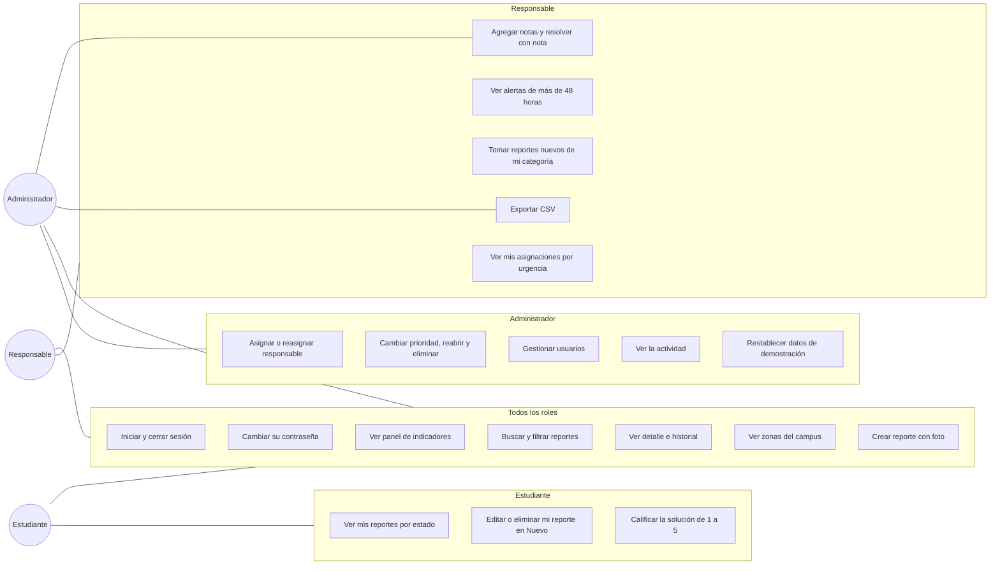

# Casos de uso por rol

Estado final (v1.0.0). Todos los casos están implementados con el servidor y en el modo navegador.

| Caso | Rol | Endpoint del backend |
|---|---|---|
| Iniciar sesión | Todos | `POST /api/auth/login` |
| Cambiar contraseña | Todos | `POST /api/auth/contrasena` |
| Crear reporte con foto | Todos | `POST /api/reportes` |
| Editar o eliminar reporte propio | Estudiante | `PUT` / `DELETE /api/reportes/{id}` |
| Calificar la solución | Estudiante | `POST /api/reportes/{id}/calificacion` |
| Tomar reporte | Responsable | `POST /api/reportes/{id}/tomar` |
| Agregar nota / resolver / reabrir | Responsable asignado, administrador | `POST /api/reportes/{id}/notas`, `/estado` |
| Asignar responsable | Administrador | `POST /api/reportes/{id}/asignacion` |
| Cambiar prioridad | Administrador | `PATCH /api/reportes/{id}/prioridad` |
| Gestionar usuarios | Administrador | `/api/usuarios` |
| Ver actividad | Administrador | `GET /api/auditoria` |
