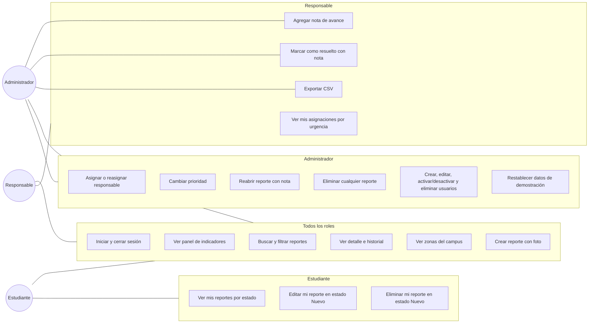

# Casos de uso por rol

Qué puede hacer cada rol en la versión 0.3.0. Los casos marcados con *(entrega final)* están previstos pero no implementados.

## Casos previstos para la entrega final

| Caso | Rol |
|---|---|
| Iniciar sesión con contraseña propia validada por el servidor | Todos |
| Cambiar la contraseña | Todos |
| Subir la foto al servidor en lugar de guardarla en el navegador | Todos |
| Calificar la solución de un reporte resuelto | Estudiante |
| Tomar un reporte nuevo de su categoría sin esperar asignación | Responsable |
| Ver alertas de reportes que superan las 48 horas | Responsable y administrador |
| Consultar el registro de auditoría | Administrador |
