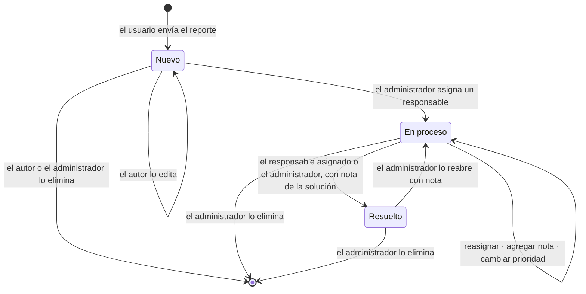

# Ciclo de vida de un reporte

Las transiciones están definidas en `TRANSICIONES` de `src/models/reporte.js`. El servicio de reportes rechaza cualquier otra.

| Desde | Hacia | Quién | Condición |
|---|---|---|---|
| Nuevo | En proceso | Administrador | Al asignar un responsable activo. |
| En proceso | Resuelto | Responsable asignado o administrador | Nota de al menos 10 caracteres. Se guarda la fecha de solución. |
| Resuelto | En proceso | Administrador | Nota de al menos 10 caracteres explicando por qué se reabre. |

Cada cambio, nota, edición, asignación o cambio de prioridad agrega una línea al historial con fecha, estado y nombre de quien lo hizo.
