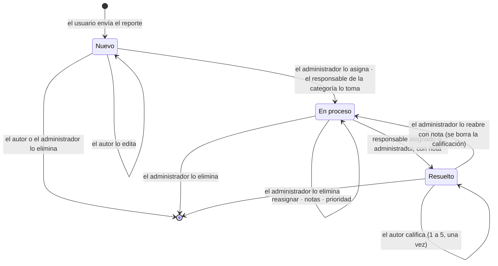

# Ciclo de vida de un reporte

Las transiciones están en `TRANSICIONES` (`src/models/reporte.js` y `backend/app/validacion.py`). Los servicios rechazan cualquier otra.

| Desde | Hacia | Quién | Condición |
|---|---|---|---|
| Nuevo | En proceso | Administrador | Al asignar un responsable activo. |
| Nuevo | En proceso | Responsable | Al tomarlo, si es de una de sus categorías y nadie lo tiene. |
| En proceso | Resuelto | Responsable asignado o administrador | Nota de al menos 10 caracteres. Se guarda la fecha de solución. |
| Resuelto | En proceso | Administrador | Nota de al menos 10 caracteres. Se borra la calificación. |

**Alerta de 48 horas:** un reporte sin resolver que lleva más de `META_HORAS` (48) desde su creación muestra la etiqueta *Más de 48 h*. El responsable ve un aviso y el panel los cuenta.

Cada cambio, nota, edición, asignación, prioridad o calificación agrega una línea al historial con fecha, estado y nombre de quien lo hizo, y queda en la auditoría.
