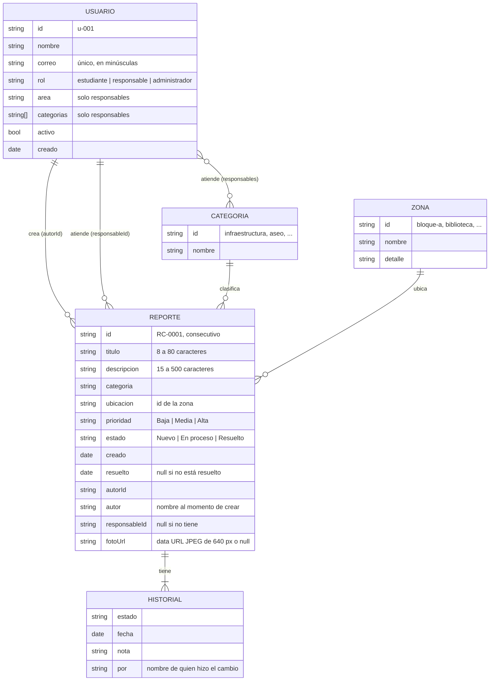

# Modelo de datos

Estructura de los objetos que guarda la aplicación en esta fase. En la entrega final cada entidad será una tabla de SQL Server (ver [ADR-005](../decisiones_tecnicas/ADR-005-estrategia-backend.md)).

Las categorías y zonas son catálogos fijos en `src/models/catalogos.js`.
