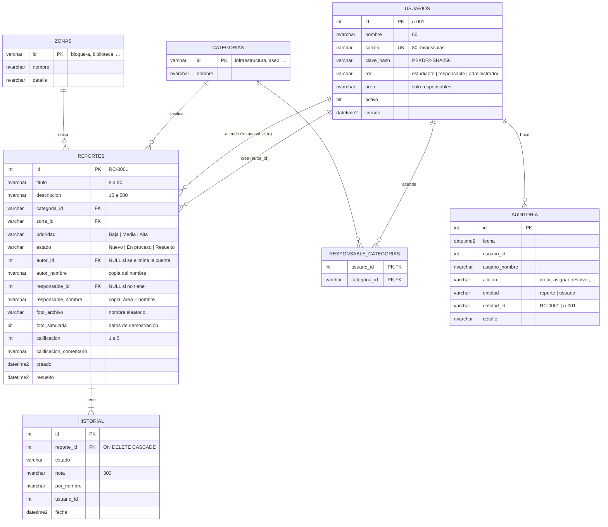

# Modelo de datos

Tablas de la base de datos (`backend/app/modelos.py`). El script para SQL Server está en [`backend/sql/esquema-sqlserver.sql`](../../backend/sql/esquema-sqlserver.sql). En el modo navegador se guardan los mismos datos como objetos JSON con los códigos `RC-0001` y `u-001`.

Restricciones en la base de datos: rol, estado y prioridad con `CHECK`, calificación entre 1 y 5, correo único e índices por estado, responsable y autor.

Los nombres del autor y del responsable se copian en el reporte para que se conserven si la cuenta se elimina.
