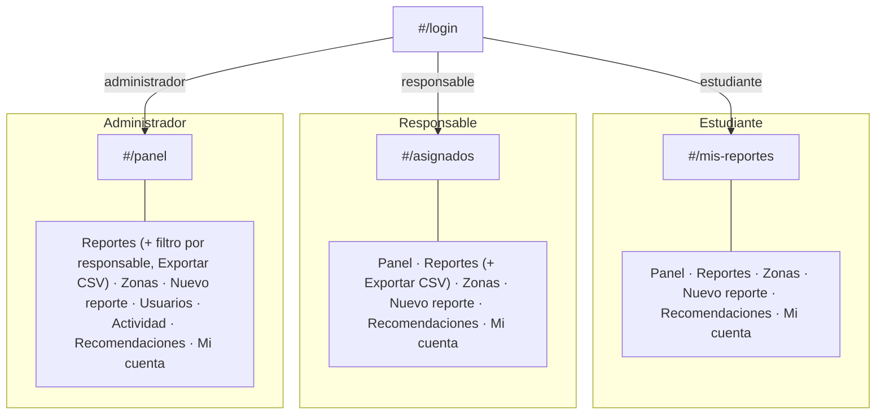

# Navegación por rol

Menú y página de inicio de cada rol (`src/config/rutas.js`).

| Situación | Resultado |
|---|---|
| Sin sesión, abre `#/zonas` | Va a `#/login`; después de entrar vuelve a `#/zonas`. |
| Estudiante abre `#/usuarios` o `#/actividad` | Vuelve a `#/mis-reportes` con el aviso *No tienes acceso a esa sección*. |
| Con sesión abre `#/login` | Va a la página de inicio de su rol. |
| El servidor responde 401 | Cierra la sesión y vuelve a `#/login` con *Tu sesión terminó*. |
| Ruta que no existe | Va a la página de inicio (o al inicio de sesión). |
