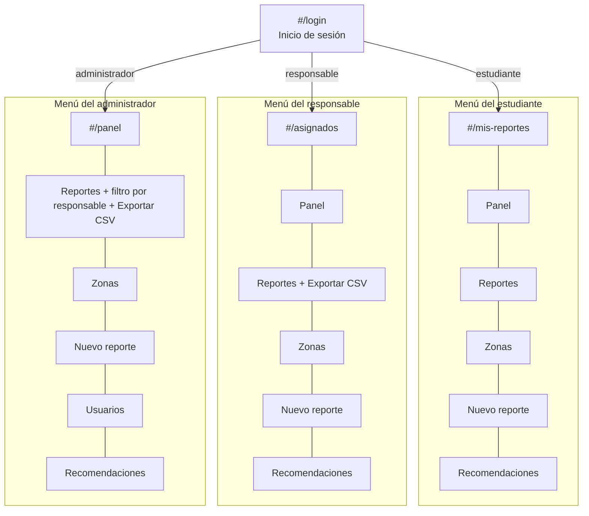

# Navegación por rol

Menú lateral y página de inicio de cada rol. Las rutas y sus permisos están en `src/config/rutas.js`.

| Situación | Resultado |
|---|---|
| Sin sesión, abre `#/zonas` | Va a `#/login`; después de entrar vuelve a `#/zonas`. |
| Estudiante abre `#/usuarios` | Vuelve a `#/mis-reportes` con el aviso *No tienes acceso a esa sección*. |
| Con sesión abre `#/login` | Va a la página de inicio de su rol. |
| Ruta que no existe | Va a la página de inicio (o al inicio de sesión). |
| Enlace de la v0.2 (`#zonas`) | Abre la página correspondiente. |
