# Manual de usuario de ReportaCampus

ReportaCampus sirve para reportar daños, fallas y problemas de aseo o de seguridad del campus, y para seguir su atención hasta que se resuelven. Este manual explica qué puede hacer cada tipo de usuario.

**Dirección:** <https://elone1415.github.io/ReportaCampus/> (demostración) o la dirección que te dé el administrador si se usa con servidor.

## 1. Entrar

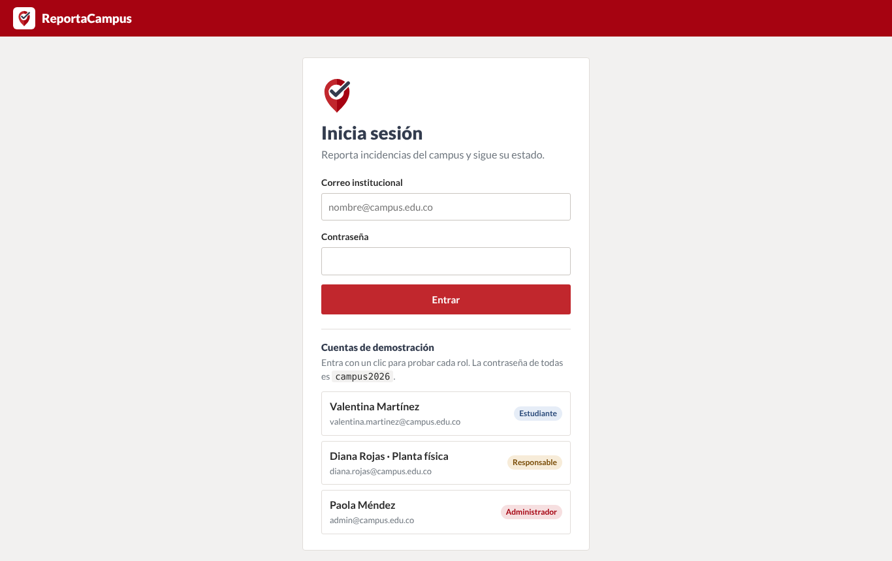

1. Escribe tu correo institucional y tu contraseña, y pulsa **Entrar**.
2. Para probar la aplicación puedes usar los botones de **Cuentas de demostración**: entran directo como estudiante, responsable o administrador. La contraseña de todas es `campus2026`.

| Mensaje | Qué significa |
|---|---|
| *El correo o la contraseña no son correctos.* | Revisa lo que escribiste. |
| *Esta cuenta está desactivada.* | El administrador desactivó tu cuenta. Habla con él. |
| *Tu sesión terminó. Inicia sesión de nuevo.* | Pasaron más de 8 horas o tu cuenta cambió. Vuelve a entrar. |

Para salir, pulsa **Cerrar sesión** (en celular, **Salir**) en la barra superior. La sesión también se cierra al cerrar la pestaña.

## 2. Partes de la pantalla

- **Barra superior:** tu nombre (lleva a *Mi cuenta*), tu rol y el botón para salir.
- **Menú lateral:** solo muestra las secciones de tu rol. En celular se abre con el botón ☰.
- **Pie de página:** indica de dónde vienen los datos. *Datos del servidor* quiere decir que todos ven la misma información; *Demostración* quiere decir que los cambios quedan solo en tu navegador.
- **Avisos:** aparecen abajo a la derecha. Los de error son rojos.
- Si una página no puede cargar los datos (por ejemplo, sin internet), lo dice arriba y muestra el botón **Reintentar**.

## 3. Estudiante

### Mis reportes

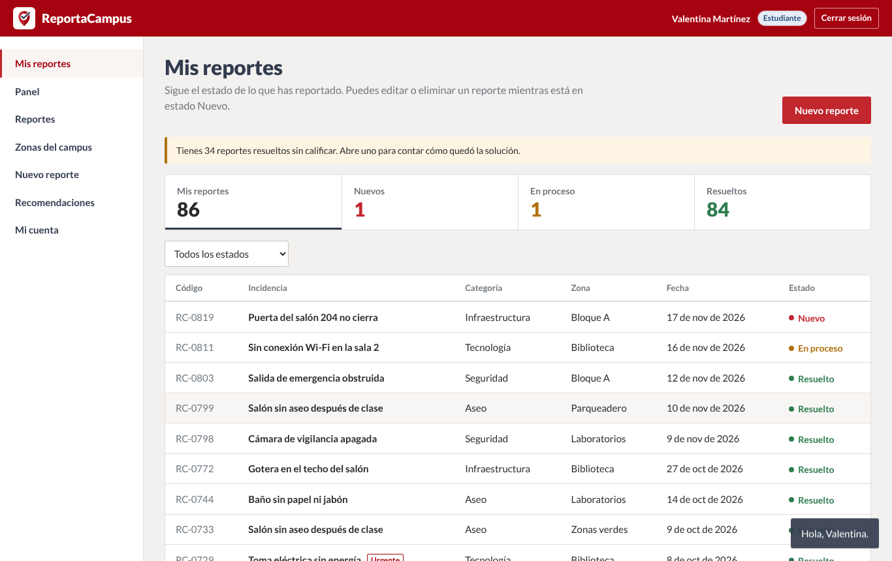

Es la página de inicio del estudiante. Arriba están el total y cuántos de tus reportes están en cada estado; al pulsar una cifra se filtra la lista. Pulsa una fila para ver el detalle y el historial.

### Crear un reporte

1. Pulsa **Nuevo reporte**.
2. Elige la **categoría** y la **zona**, escribe un **título** (8 a 80 caracteres) y una **descripción** (15 a 500 caracteres) y elige la **prioridad**. Usa *Alta* solo para riesgos, como cables expuestos o fugas.
3. Si quieres, agrega una **foto**: verás una vista previa y la puedes quitar.
4. Pulsa **Enviar reporte**. Recibes un código (por ejemplo, *RC-0820*) y el reporte aparece resaltado en *Mis reportes*.

Si falta algo, el campo se marca en rojo con el motivo.

### Editar o eliminar

Mientras el reporte está en estado **Nuevo** (nadie lo ha tomado), en el detalle aparecen **Editar** y **Eliminar reporte**. La edición queda en el historial. Eliminar pide confirmación.

### Calificar la solución

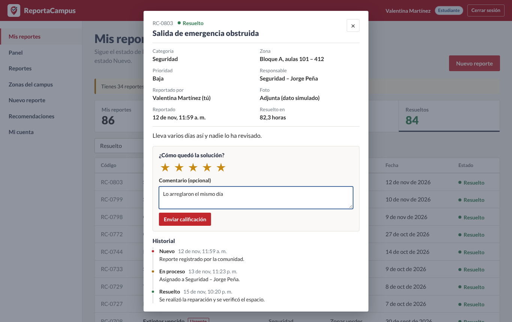

Cuando un reporte tuyo queda **Resuelto**, ábrelo, elige de 1 a 5 estrellas, escribe un comentario si quieres y pulsa **Enviar calificación**. Solo se puede calificar una vez. *Mis reportes* te avisa cuántos tienes sin calificar.

## 4. Responsable

### Mis asignaciones

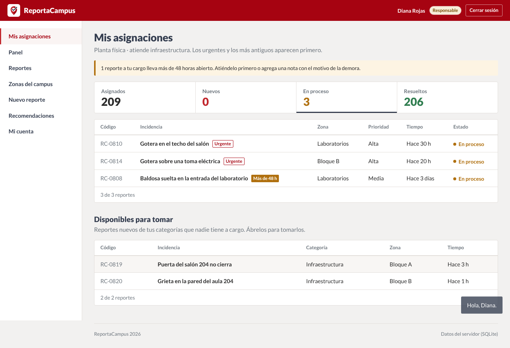

Es la página de inicio del responsable. Muestra tu área, las categorías que atiendes y los reportes a tu cargo, primero los urgentes y los más antiguos. Los que llevan más de 48 horas abiertos tienen la etiqueta **Más de 48 h** y un aviso arriba.

Abajo está **Disponibles para tomar**: reportes nuevos de tus categorías que nadie tiene a cargo.

### Tomar un reporte

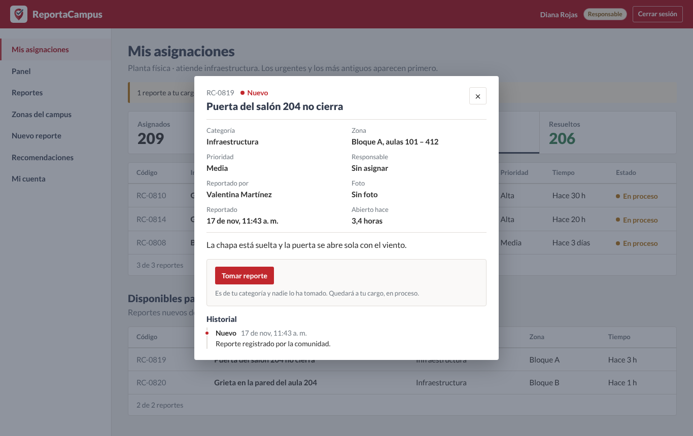

Abre un reporte disponible y pulsa **Tomar reporte**. Queda a tu cargo y pasa a **En proceso**.

### Atender y resolver

En el detalle de un reporte a tu cargo:

- **Agregar nota:** escribe el avance (mínimo 10 caracteres). Queda en el historial con tu nombre.
- **Marcar como resuelto:** describe qué se hizo (mínimo 10 caracteres). El reporte pasa a **Resuelto** y su autor puede calificarlo.

En los reportes de otros responsables solo puedes ver el detalle.

### Exportar

En **Reportes**, el botón **Exportar CSV** descarga los reportes que coinciden con la búsqueda y los filtros, listos para abrir en Excel.

## 5. Administrador

### Panel

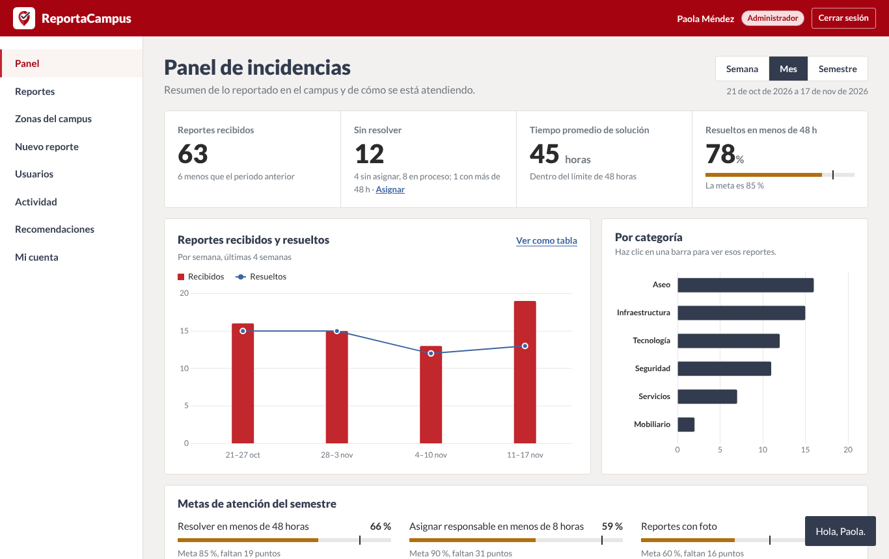

Indicadores del periodo (semana, mes o semestre), gráficas de reportes recibidos y resueltos y por categoría, y metas de atención. En *Sin resolver*, el enlace **Asignar** abre la lista de reportes nuevos sin responsable. Pulsa una barra de la gráfica por categoría para ver esos reportes.

### Gestionar un reporte

Al abrir cualquier reporte, en **Gestión del reporte** puedes:

- **Asignar** o **Reasignar** el responsable. La lista muestra primero a quien atiende esa categoría. Un reporte nuevo pasa a En proceso.
- **Cambiar prioridad.**
- **Eliminar reporte** (pide confirmación).
- Agregar notas, **resolverlo** o **reabrirlo**. Para reabrir hay que explicar el motivo, y la calificación anterior se borra.

En **Reportes** tienes además el filtro por responsable, con la opción *Sin asignar*.

### Usuarios

- **Nuevo usuario:** nombre, correo (no se puede repetir) y rol. Para un responsable también se pide su área y las categorías que atiende. La cuenta entra con la contraseña inicial (`campus2026` en la demostración) y la persona la cambia en *Mi cuenta*.
- **Editar**, **Desactivar** o **Activar**, y **Eliminar**. Una cuenta desactivada no puede entrar; si alguien la estaba usando, su sesión se cierra.
- No se puede eliminar ni desactivar tu propia cuenta, quitar el último administrador, ni eliminar o desactivar a un responsable que tenga reportes sin resolver (primero hay que reasignarlos).
- **Restablecer datos** vuelve a los datos de demostración.

### Actividad

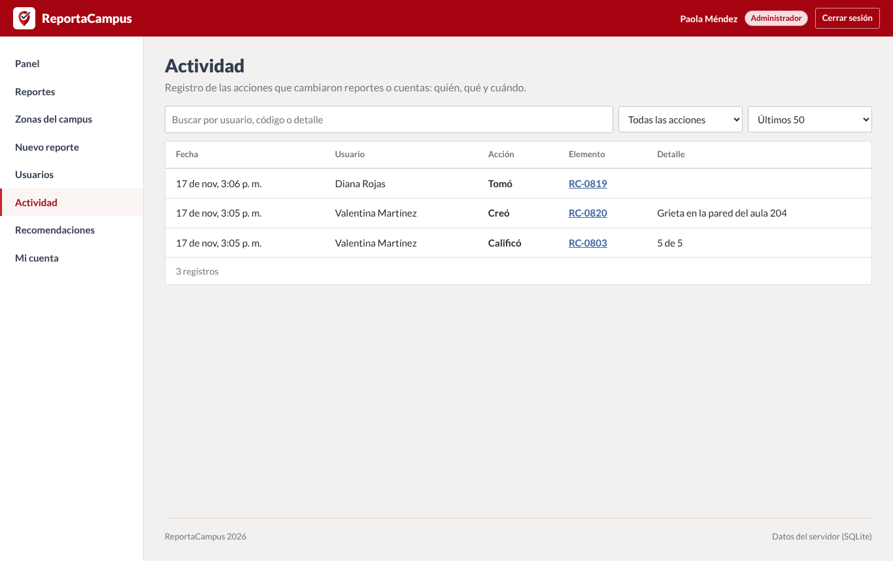

Registro de quién hizo qué y cuándo: crear, editar, asignar, tomar, resolver, reabrir, cambiar prioridad, calificar y cambios de cuentas. Se puede buscar y filtrar por acción, y el código de cada reporte abre su detalle.

## 6. Mi cuenta (todos los roles)

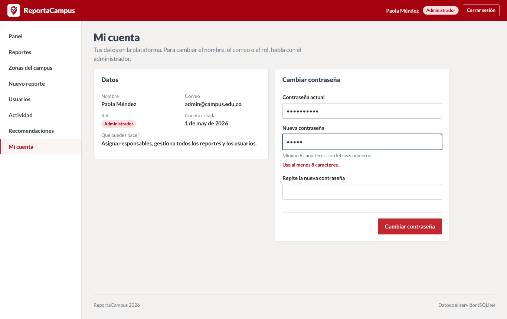

Muestra tus datos y tu rol, y permite **cambiar la contraseña**: escribe la actual y la nueva dos veces. La nueva debe tener al menos 8 caracteres y combinar letras y números. Para cambiar tu nombre, correo o rol, habla con el administrador.

## 7. En el celular

La aplicación se adapta a celulares y tabletas. El menú se abre con ☰, las tablas se muestran como tarjetas y el nombre de la barra superior se oculta para dejar espacio.

| Mis asignaciones | Mi cuenta | Actividad |
|---|---|---|
| 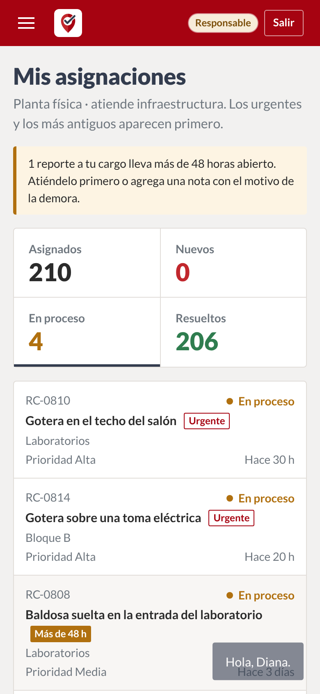 | 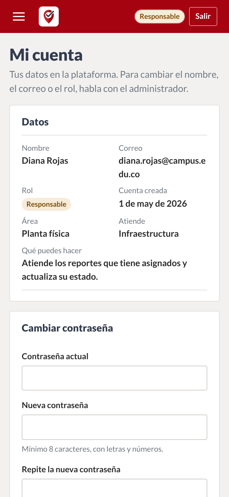 | 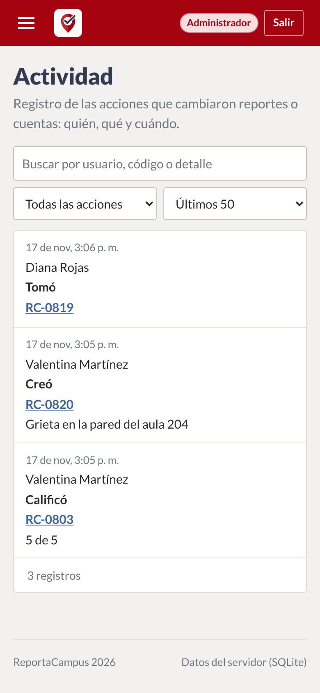 |

## 8. Preguntas frecuentes

**¿Por qué no veo mi reporte en otro computador?** En la demostración de GitHub Pages los datos se guardan en cada navegador. Con el servidor, todos ven los mismos datos.

**¿Puedo cambiar un reporte que ya tomaron?** No. Agrega la información pidiéndole al responsable que la anote, o crea un reporte nuevo.

**¿Qué hago si la página dice que no hay conexión?** Revisa tu internet y pulsa **Reintentar**. Lo que estabas escribiendo en un formulario no se borra.
